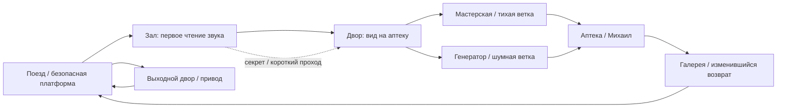

# Как строить и оформлять уровни «Последнего рейса»

Исследование и художественная спецификация, 17.10.2026. Это план будущих
локаций к [сценарию 25 уровней](campaign-scenario-v040.md). Карты/арт сейчас
не добавляются в Godot. Сохраняем выбранную настоящую 2.5D и установленный
образ персонажей; новые постановки ниже ещё не являются художественной приёмкой.

## Что реально изучено

1. Рассмотрены сохранённые игровые кадры Death’s Door и Hades:
   `design/references/894020-reference.jpg`, `1145360-reference.jpg`.
   Это чужие рекламные изображения для анализа. Они не входят в игровые ассеты.
2. Прочитана статья разработчика Andrew Shouldice о построении открытия через
   предметный игровой справочник. В ней описаны постепенно собираемая информация
   и ощущение обнаружения секрета, который уже был рядом.
   [Tunic — статья автора](https://blog.playstation.com/?p=370009).
3. Проверена страница доклада автора Tunic: секрет может оставлять след для
   следующего открытия. Прочитаны описание и данные доклада; полное видео
   не заявляется просмотренным.
   [GDC: This Was Here the Whole Time](https://gdcvault.com/play/1029384/-TUNIC-This-Was-Here).
4. Прочитаны доступные слайды Jolie Menzel: цель, доступная информация,
   обратная связь, применение уже освоенных действий и наблюдение за игроком.
   [GDC: Solving Puzzle Design](https://media.gdcvault.com/gdc2016/Presentations/Menzel_Jolie_Level%20Design%20Workshop.pdf).
5. Проверено описание разбора процесса итераций конкретного уровня Guerrilla.
   Это квест Horizon Forbidden West с названием Death’s Door, **другая игра**;
   источник полезен как пример процесса, не как свидетельство об Acid Nerve.
   [GDC: Knocking on Death’s Door](https://www.gdcvault.com/play/1027764).

Не все найденные страницы дали доступ к полным материалам: крупный PDF
Steve Lee не открылся через браузерный инструмент. Его содержание не
используется как прочитанный источник. Никакие зависимости/MCP для исследования
не устанавливались. Не утверждается, что готовые игры были здесь лично пройдены.

## Что видно в игровых кадрах

**Death’s Door.** В просмотренном тихом кадре путь образован крупными светлыми
плитами; листья и камни сгруппированы по краям. Лестница и перила показывают
высоту. Статуя создаёт заметную точку, а маленький тёмный герой отделяется
от светлой поверхности. Скамья задаёт человеческий масштаб. Это наблюдения
конкретного кадра, не разбор всех уровней игры.

Применение у нас: крупные формы платформы/навеса/вагона, чистая полоса движения,
мусор у оснований стен, водостоков и складских карманов. Высоту показывают
реальные торцы, опоры, тени и парапеты. В каждом виде — одна главная точка,
например фонарь Лиды, окно убежища или красный семафор.

**Hades.** В просмотренном боевом кадре яркий удар и враги отделяются от менее
контрастной основной поверхности. Колонны создают направления обхода,
орнамент помогает читать геометрию. За пределами игрового пространства детали
темнее. Это наша визуальная интерпретация кадра; способ рендера Hades ею
не доказывается и не заменяет выбранный стек Godot.

Применение у нас: свободное пространство для направления удара/уклонения,
укрытия с понятными обходами, видимая подготовка врага телом. Свет помогает
видеть фигуры, ржавчина и блики не имитируют маркеры опасной атаки.

**Tunic.** Для нашего мира полезен принцип знания: игрок замечает новое
значение старого объекта. В железнодорожной среде это схема поста, потертость
на калитке, отметка на стене, а не скопированный шифр или чужой справочник.
Основной путь остаётся читаемым; глубокие загадки добровольны.

## Пространственный язык

Уровень начинается с вида на цель, затем даёт выбор, препятствие и возвращение
с новой связью. На входе игрок видит хотя бы один ориентир, который узнает
после обхода. Дальний закрытый проход показывает, что к нему можно подойти
с обратной стороны. Открытый срез действительно уменьшает повторный путь.

Это будущая композиция района, а не точная копия нынешних прямоугольников
0.39. Окончательное размещение зависит от blockout и игровых проверок.

Для каждого из 25 уровней нужна карточка: входной вид, ближайшая понятная
цель, главный ориентир, маршрут, обход, два-три различных игровых эпизода,
пауза, изменение мира, выход и необязательная находка. План не заставляет
каждый уровень иметь одинаковое число боёв или один и тот же замок.

## Композиция игрового кадра

**Передний план:** крупный навес, перила или кабель обрамляют вид, не перекрывая
героя/замах врага. Для мешающих элементов предусмотрено проверяемое затухание
или другой силуэт. Мелкие детали перед камерой не получают случайные коллайдеры.

**Игровой план:** поверхность достаточно спокойна по контрасту; двери,
укрытия, цели и опасные границы различимы. В местах боя есть пространство
для двухметрового dodge. Ширина главных боевых/эвакуационных дверей проверяется
реальной капсулой и каталкой; ориентир для широких проходов — 3–4 м.

**Дальний план:** видны вагон, высокая арка, окна или диспетчерская. Вода,
туман и свет дают глубину, а не закрывают игровые объекты. Недоступный настил
отличается торцом/разрывом/ограждением, не невидимой стеной на одинаковом полу.

Герой остаётся около 1.78 м; скамьи, дверные ручки и ступени сверяются с ним.
Масштаб не исправляется растягиванием тела или случайным зумом камеры.
Светом обозначаются направление и функция, но цвет всегда дополнен формой.

Текущий AStarGrid2D работает на XZ и не доказывает поддержку двух проходимых
этажей друг над другом. Для кадров «галерея над водой» вода может быть фоном.
Если понадобятся пересекающиеся игровые этажи, сначала отдельное решение
навигации/коллизий и тест, затем обещание такой геометрии.

## Пять районов: формы и материалы

| Район | Главная форма | Свет и материал | Бытовой след | Игровой контраст |
|---|---|---|---|---|
| Станция | Длинный вагон, арка зала, низкие навесы | Холодный камень, оливковый металл, тёплые лампы | Следы тележек, свежая перевязка | Узкий освещённый путь и широкий обход |
| Больница | Светящийся этаж над низким двором | Побелка, матовое стекло, зелёная краска | Обувь у выхода, сумка, карточки | Защищённые точки ожидания и открытый двор |
| Рабочий посёлок | Разные крыши, дворики, провода к посту | Тёплые окна, влажный кирпич, ткань | Стирка, новые перчатки, рабочий допуск | Дом как пауза, канал как риск |
| Водосброс | Арки, опоры, высокая будка | Сланцевый бетон, белая вода, ржавые кромки | Сегодняшние отметки поверх старых | Зелёная лампа и физически опасный главный путь |
| Старая платформа | Знакомый столб, семафор, настил | Чёрное мокрое дерево, сталь, свет верхнего перрона | Расчищенный людьми проход | Финальная открытая связь вместо прежнего тупика |

Это предложения постановки в пределах выбранного направления. Новый стиль
персонажей не вводится. Для повторяющихся модулей нужны варианты износа,
другая композиция и функция; 25 отдельных уникальных наборов ассетов не требуются.

## Три постановочных кадра перед серийным производством

1. **Фонарь у вагона.** Диагональ состава ведёт к человеку, тёплый свет
   выделяет лицо/плечи, за стеклом читается движение угрозы. Виден сухой
   путь до двери. В спокойном кадре минимум лишних UI-маркеров.
2. **Аптека и обратные жалюзи.** Сначала из двора видна цель, затем изнутри
   виден новый выход. В кадре с каталкой можно оценить ширину разворота.
   Мебель и стойки образуют читаемую границу, не мелкий слалом коллизий.
3. **Семафор и люди.** Дальняя верхняя платформа, средний план настила и
   близкий ручной пост. Порядок работы читается по реальному расположению
   людей и деталей. Полосы света поддерживают направление перехода.

Сначала эти кадры получают нарисованную композицию/блокировку, затем реальный
рендер в Godot. Здесь ещё нет утверждения, что такое оформление произведено.

## Загадки, секреты и темп

Загадка требует заметить отношение объектов или применить известное действие
в новой ситуации. Несколько пунктов «удержать E» сами по себе ещё не интересная
головоломка. Игрок видит, почему механизм не работает, может проверить гипотезу
и сохранить результат. Каталог — [puzzles-secrets-v040.md](puzzles-secrets-v040.md).

За спокойным наблюдением следует применение, затем новое сочетание: звук
отвлекает одиночного врага; позже открывает путь с носилками; в финале помогает
держать проход. Знакомое действие получает иную задачу, а не растущую длину
ожидания. У технической задачи безопасное рабочее место, бой — на подходах.

Пасхалка может быть смешной и короткой. Сюжетный секрет должен что-то менять
в понимании места или человека. Оба вида добровольны; основной смысл и
спасение доступны без полного сбора находок.

## Последовательность после сценарной стадии

1. Зафиксировать карточки 25 уровней и связи загадок/реплик, проверить канон.
2. Нарисовать несколько композиций первой главы и два варианта маршрута.
3. Сделать один связанный blockout; пройти туда/обратно с носилками, проверить
   бой, обе ветви, сохранение и доступность секретов.
4. Довести один короткий участок до нужного художественного вида и проверить
   игровым рендером. Показать масштаб, взаимодействия и движение вместе.
5. Из проверенного набора строить следующие уровни, с отдельным назначением
   каждого; длительность подтверждать человеческим первым прохождением.

До завершения текущей сценарной стадии пункты 2–5 не выполняются автоматически.
